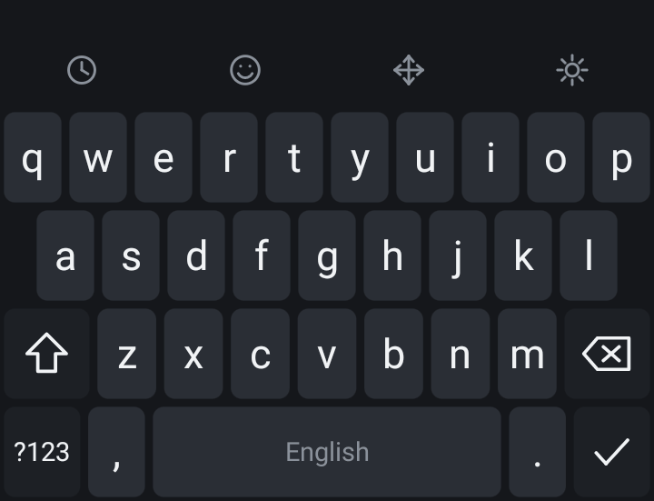
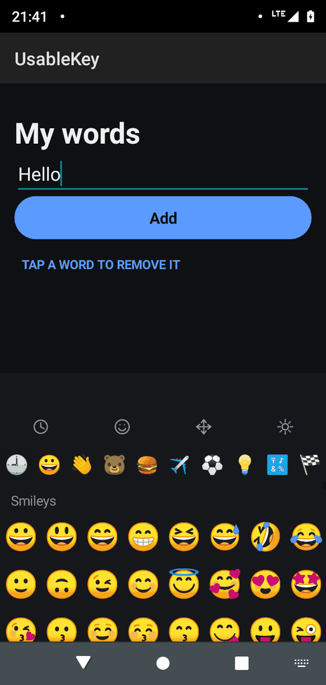
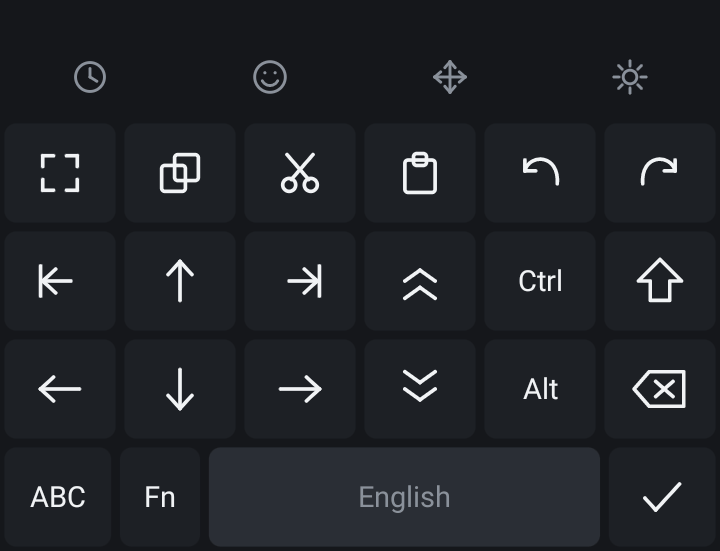
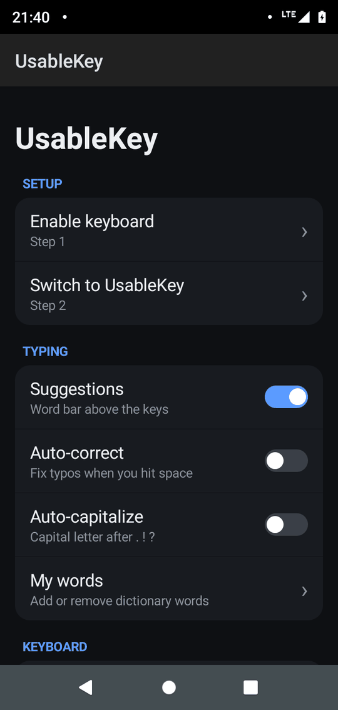
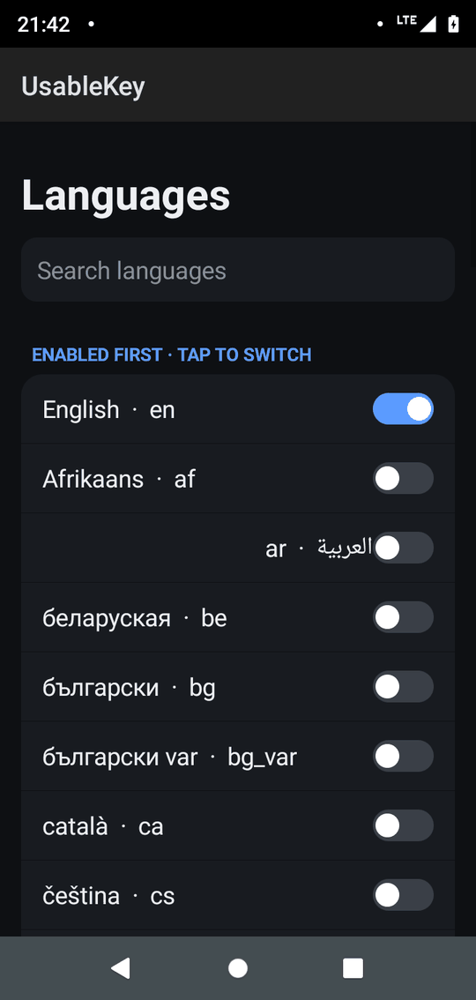
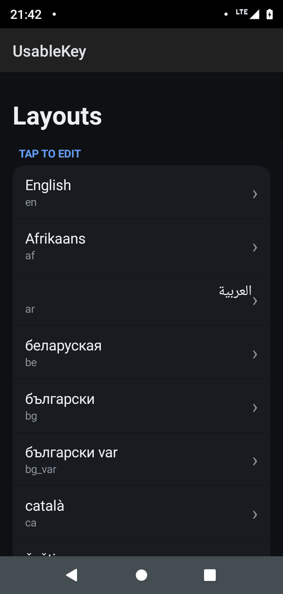
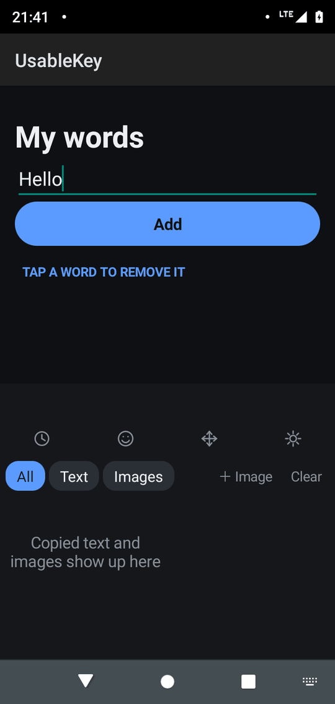
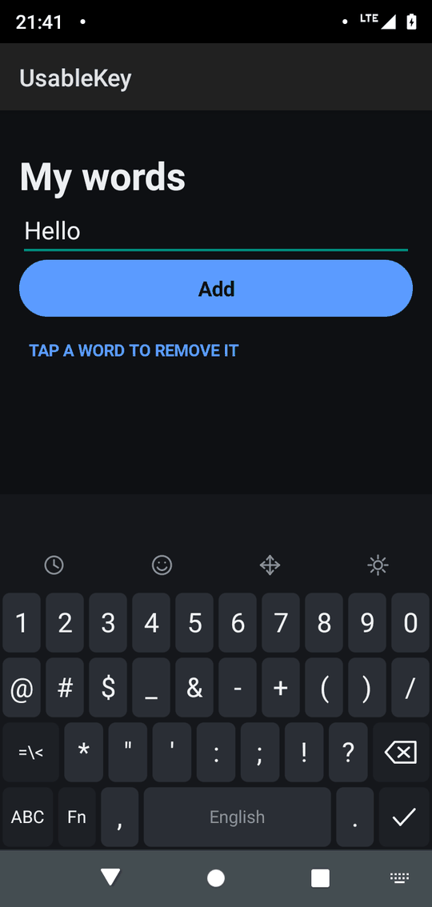
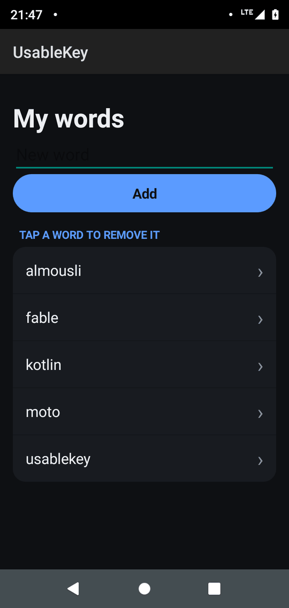

<div align="center">

# ⌨️ UsableKey

**The tiny, fast keyboard for every Android — runs on Android 1.5+, under 1 MB, 60+ layouts, offline suggestions, emoji and clipboard history.**

[](https://github.com/mkalmousli/UsableKey/actions/workflows/build.yml)
[](https://github.com/mkalmousli/UsableKey/releases/latest)
[](LICENSE)


[**Download APK**](https://github.com/mkalmousli/UsableKey/releases/latest) · [**Website**](https://mkalmousli.github.io/UsableKey/) · [Report a bug](https://github.com/mkalmousli/UsableKey/issues)





</div>

## Features

- **60+ layouts** generated from Unicode CLDR — QWERTY, QWERTZ, AZERTY, Dvorak, Colemak, Cyrillic, Arabic, Hebrew, Thai, Devanagari and more
- **Offline word suggestions & auto-correct** for 13 languages (en, de, fr, es, it, pt, nl, pl, tr, sv, uk, ru, ar), with fuzzy matching and a personal dictionary
- **Emoji panel** with categories, recents and flags
- **Clipboard history** for text and images, with an image shelf you can send into apps that accept images
- **Editing tools row**: cursor arrows, select, cut/copy/paste, undo/redo, Ctrl/Alt/Fn modifiers
- **Swipe-down symbols & key hints**, long-press accents, optional number row
- **Dark / light / AMOLED / blue themes**, adjustable key height and long-press delay
- **Haptic and sound feedback**, key preview popups
- **Private by design**: no `INTERNET` permission, no analytics, no accounts. Everything stays on your device
- **Runs on old phones**: minSdk 3 (Android 1.5) up to Android 14, so it fits devices most keyboards dropped long ago
- **Tiny and lean**: whole APK under 1 MB, ~3,700 lines of Java, no third-party libraries

## Screenshots

| Settings | Languages | Layouts |
|---|---|---|
|  |  |  |

| Clipboard | Symbols | My words |
|---|---|---|
|  |  |  |

## Install

1. Download `UsableKey-*.apk` from the [latest release](https://github.com/mkalmousli/UsableKey/releases/latest) and install it.
2. Open **UsableKey**, tap **Enable keyboard** (Step 1), then **Switch to UsableKey** (Step 2).
3. Pick your languages under **Languages**.

## Build from source

Requirements: JDK 17+, Python 3, Android SDK with `platforms;android-34` and build-tools (set `ANDROID_HOME`, default `~/Android/Sdk`). No Gradle needed.

```bash
python3 build.py            # check + build -> out/usablekey.apk
python3 build.py install    # build and adb install
python3 build.py layouts    # regenerate layouts from CLDR
python3 build.py dict       # regenerate dictionaries (FrequencyWords)
python3 build.py emoji      # regenerate emoji list
```

The first build creates a local signing key at `~/.android/usablekey.keystore`.
Source files are kept under 100 lines each (`python3 build.py check`).

## Releases

Pushing a tag like `v1.0.0` triggers GitHub Actions to build the APK and publish a release:

```bash
git tag v1.0.0 && git push --tags
```

> Release APKs are signed with a throwaway CI key, so updating from a locally built APK requires uninstalling first.

## Project layout

```
src/dev/usablekey/   Java sources (ime, input, layout, predict, clip, emoji, media, settings, view)
assets/              dictionaries (.dic), layouts (lay/), emoji list
tools/               pure-Python build system and data generators
docs/                GitHub Pages site and screenshots
```

## Author

Made by **[Mohamad Almousli](https://al-mo.de)** — [al-mo.de](https://al-mo.de) · [@mkalmousli](https://github.com/mkalmousli)

## License

[MIT](LICENSE) © 2026 Mohamad Almousli
